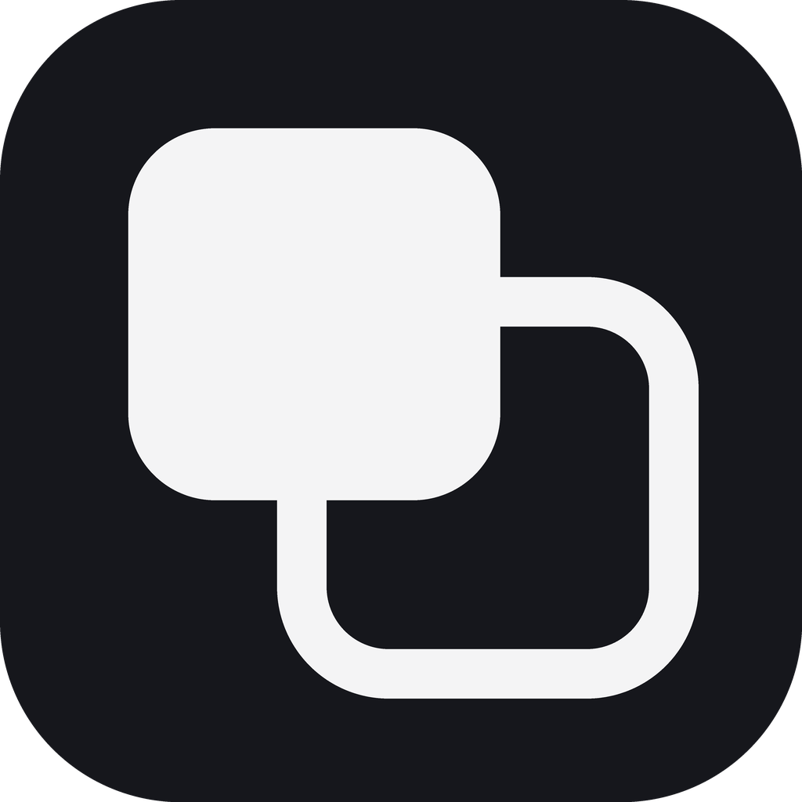

<div align="center">



# Layr

**Annotate any image, export it sharp.**

[](https://github.com/adamhlt/Layr/actions/workflows/ci.yml)
[](https://github.com/adamhlt/Layr/releases/latest)


[](LICENSE)

</div>

---

Layr is a native desktop editor for drawing boxes, badges, wires, arrows, measures and captions
over photos, then exporting the result in full resolution. It can also stitch overlapping photos
into one large image first. It's made for repair notes, technical documentation and annotated
screenshots.

<p align="center"></p>

## Features

**Annotate**
- Boxes, hatched areas, wires, arrows, dots and captions
- Numbered badges that count up by themselves, in five shapes
- Real-world measures from a scale you set once
- A legend built in one click from the styles on the image
- Any installed font, colours with opacity, a palette saved between sessions
- Undo, copy and paste, crisp at any zoom

**Stitch**
- Join overlapping photos into one large image: a die under a microscope, a board, a page, a wall
- In any order, turned or taken at an angle: Layr finds what they have in common
- Seamless, without ghosting, blended band by band with brightness matched between photos
- Cropped to a clean rectangle, opened to annotate or saved at full size (up to 200 megapixels)

**Export**
- PNG, JPEG, WebP or PDF, with vector shapes and selectable text in PDFs
- The whole image, an area you select, or without the empty edges of a mosaic
- Scaled from 25 % to 200 %, with or without the photo underneath

**Open** (`Ctrl+O`) one image, or a list of photos to stitch: pick several at once, add a folder,
or drop them on the window.

<p align="center"></p>
<p align="center"><sub>Siemens SAB 8086 die (an Intel 8086 made under licence) by <a href="https://commons.wikimedia.org/wiki/File:Siemens_SAB_8086_die.JPG">Pauli Rautakorpi</a>, <a href="https://creativecommons.org/licenses/by/3.0/">CC BY 3.0</a>, resized and annotated. Block positions from Ken Shirriff's <a href="https://www.righto.com/2020/06/a-look-at-die-of-8086-processor.html">look at the 8086 die</a>.</sub></p>

## Shortcuts

| | |
| --- | --- |
| `V` `R` `H` `N` `L` `A` `P` `T` `M` | Select, rectangle, hatch, badge, wire, arrow, dot, text, measure |
| `G` | Add a legend |
| `Ctrl+C` / `Ctrl+V` · `Ctrl+D` | Copy and paste · duplicate |
| `Ctrl+Z` / `Ctrl+Y` | Undo and redo |
| `Ctrl+O` · `Ctrl+E` | Open an image or photos to stitch · export |
| `Ctrl+F` · wheel | Fit to window · zoom |
| `Space` + drag, middle or right button | Pan the view |
| `Shift` | Square boxes, lines at 45° |
| `Ctrl` + drag a handle | Resize and keep the proportions |
| `Enter` / `Esc` | Use or cancel the area being selected for export |

## Download

Get the latest build for Windows, macOS or Linux from
[**Releases**](https://github.com/adamhlt/Layr/releases/latest).

Layr checks for a new release at startup and offers to update itself (Windows setup or portable,
macOS app, Linux x86-64); anywhere else it links to the release page. Set `LAYR_NO_UPDATE_CHECK=1` to turn the
startup check off.

On macOS the app isn't notarized: the first time, right-click it and choose **Open**.

## Build

```bash
cargo run --release
```

- **Toolchain**: `rust-toolchain.toml` pins the Rust version; rustup installs it on first use.
- **Linux**: needs `libxkbcommon-dev` and `libwayland-dev`.
- **Release**: pushing a `v*` tag builds all three platforms into one GitHub release.

## Use of AI

AI assistance was used in this project, for code, tests and documentation. The authors reviewed the result and remain responsible for it.

## License

Layr is free software under the [GNU General Public License v3.0](LICENSE) or any later version.
The bundled Inter typeface is under the SIL Open Font License.

<div align="center"><sub>Built with <a href="https://github.com/anomalyco/rune">Rune</a></sub></div>
