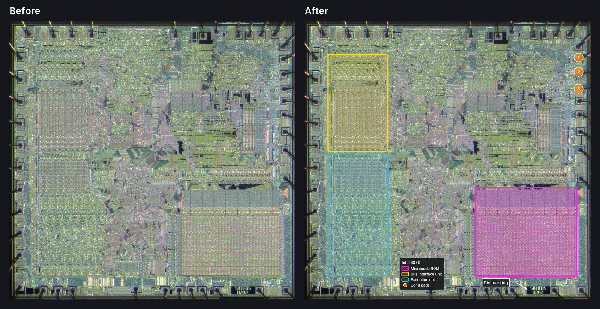

The first release of **Layr**: a native desktop editor for annotating images and exporting them in full resolution.

## Highlights

- **Nine tools**: rectangles, hatched areas, numbered badges (circle, rounded, square, diamond, hexagon), wires, arrows, dots, multi-line captions, measures and legends.
- **Real sizes**: calibrate the scale once against a known length; measures and boxes then show µm, mm, cm, m or inches.
- **One-click legend**: lists every look used on the image, with descriptions you write.
- **Styling**: any installed font, a colour editor that reads hex, `rgb()`, `hsl()` and HTML names, random flat colours, and a palette saved between sessions.
- **Export**: PNG, JPEG with adjustable quality, lossless WebP, or PDF with vector shapes and selectable text. Scale from 25 % to 200 %, with or without the photo.
- **Comfortable editing**: a vector canvas that stays sharp at any zoom, resize handles and cursors, undo/redo, copy/paste, and Style / Text / Arrange tabs.

## Downloads

| Platform | File |
| --- | --- |
| Windows 10/11 (x64), installer | `layr-windows-x64-setup.exe` |
| Windows 10/11 (x64), portable | `layr-windows-x64-portable.zip` |
| macOS 11+ (Apple silicon and Intel) | `layr-macos-universal.dmg` |
| Linux (x64) | `layr-linux-x64.tar.gz` |

- **Windows**: run the installer, which adds Layr to the Start menu and doesn't need admin rights, or unzip the portable build and run `layr.exe`. SmartScreen may warn on first launch because the app isn't signed: choose *More info* → *Run anyway*.
- **macOS**: open the disk image and drag *Layr* onto *Applications*. The app isn't notarized: right-click → *Open* the first time, or run `xattr -dr com.apple.quarantine /Applications/Layr.app`.
- **Linux**: extract and run `./layr`. It needs `libxkbcommon-x11-0` and a Vulkan driver. Copy `layr.desktop` and `layr.png` into your applications and icons folders for a menu entry.

## Good to know

- Right-button panning reads the mouse through X11 on Linux, so it doesn't work in a pure Wayland session; Space + drag and the middle button still pan.
- Projects aren't saved yet: export the annotated image when you're done.
